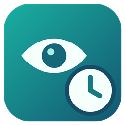

<p align="center">
  
</p>

# RestCue

一款轻量的 Windows 桌面休息提醒工具，帮助你在连续工作之间留出休息时间。

使用 C++17、Win32 和系统 GDI+ 绘制界面，无需 Qt 等第三方 GUI 框架。编译后直接运行，不需要安装或管理员权限。

**Windows 10 / 11 · 多显示器 · 托盘运行 · 本地配置**

## 目录

- [功能特性](#功能特性)
- [快速开始](#快速开始)
- [使用说明](#使用说明)
- [配置文件](#配置文件)
- [构建与测试](#构建与测试)
- [项目结构](#项目结构)
- [常见问题](#常见问题)
- [参与贡献](#参与贡献)
- [许可证](#许可证)

## 功能特性

- **自定义工作与休息时长**：按工作周期自动提醒，也可以随时开始一次休息。
- **简洁的休息界面**：柔和的青绿色渐变进度环、透明圆心和白色倒计时；结束前温和提示眨眼过渡。
- **多屏与 DPI 适配**：覆盖已连接显示器，圆环在每块屏幕上独立居中。
- **可调背景遮罩**：浓度仅影响桌面背景，不降低倒计时和圆环的清晰度。
- **托盘与开机自启**：支持收起到托盘、当前用户登录后自动启动，以及自定义关闭窗口的行为。
- **灵活的休息控制**：支持暂停、继续、跳过，也可启用禁止提前跳过的强制休息模式。
- **便携配置**：优先在程序旁保存设置，目录不可写时回退到当前用户目录。
- **本地运行**：不联网，不注册全局快捷键，不拦截键盘，不修改系统亮度或屏幕色温。

> RestCue 是休息提醒工具，不是系统锁屏工具，不保证覆盖 Windows 安全桌面或独占全屏程序。

## 快速开始

### 环境要求

- Windows 10 或 Windows 11，建议使用 x64 环境。
- 构建工具任选一种：

| 工具链 | 要求 |
| --- | --- |
| Visual Studio / Build Tools（推荐） | 安装“使用 C++ 的桌面开发”工作负载，包含 MSVC 和 Windows SDK |
| MinGW-w64 | 将 `g++` 和 `windres` 加入 `PATH` |
| Zig | 将 `zig` 加入 `PATH`，使用其自带的 C++ 编译器和资源编译器 |

### 获取源码并运行

在 **x64 Native Tools Command Prompt** 中执行以下命令；使用 MinGW-w64 或 Zig 时，可在已配置好 `PATH` 的命令提示符中执行。

```bat
git clone https://github.com/ErkundenSie/RestCue.git
cd RestCue
build.bat
build\Release\RestCue.exe
```

`build.bat` 会编译程序、嵌入图标资源并运行单元测试。编译产物统一放在 `build\Release\`，不会复制到项目根目录。

首次运行默认每工作 **45 分钟**，休息 **5 分钟**，启动后即开始计时；已有配置时会恢复保存的参数，但不会恢复上次剩余时间。

> 更新程序前，请先从托盘菜单退出旧实例。RestCue 采用单实例机制，再次启动只会唤起已运行的程序，不会替换旧进程。

## 使用说明

### 设置与操作

| 设置 / 操作 | 说明 |
| --- | --- |
| 工作间隔 | 1～1440 分钟 |
| 休息时长 | 分别填写分钟与秒，总时长为 1 秒～120 分钟；秒数范围为 0～59 |
| 遮罩浓度 | 10～95%，数值越大背景越暗；支持滑块和直接输入 |
| 保存 | 保存并应用设置，从完整的工作间隔重新计时 |
| 立即休息 | 使用已应用的参数开始休息；修改时长后需先点“保存” |
| 暂停 / 继续 | 保留剩余时间；暂停休息时会隐藏遮罩 |
| 跳过休息 | 在休息浮窗上右键单击，或使用设置页 / 托盘菜单中的“跳过休息” |
| 强制休息 | 启用后，休息期间不能通过暂停或跳过操作提前结束 |

### 休息与托盘行为

- 休息时显示进度圆环、倒计时及“休息一下，看看远处”，结束前（最后 15 秒，短休息按总时长 1/3）切换为“眨眨眼，准备继续吧”。
- 普通模式下，**右键单击休息浮窗**可结束本次休息并重新开始工作周期；左键和 `Esc` 不触发跳过。
- 休息结束后遮罩自动淡出。休息前已打开的设置页会暂时收起，结束后恢复；原本在托盘运行时不会自动弹出设置页。
- 最小化窗口会收起到托盘，关闭窗口默认也会收起。取消“关闭时最小化到托盘”后，关闭窗口将退出程序。
- 单击托盘图标打开设置，右键打开操作菜单。若系统托盘不可用，程序不会隐藏窗口，关闭窗口将直接退出。
- 勾选“开机自启”并保存后，下次登录 Windows 时在托盘启动；取消勾选并保存可移除自启。
- 从睡眠恢复后，活动中的计时会重新开始一个工作周期，不补发睡眠期间的提醒；已暂停的计时保持暂停。

## 配置文件

推荐通过界面调整设置。配置保存位置如下：

| 位置 | 用途 |
| --- | --- |
| EXE 同目录下的 `RestCue.ini` | 首选，便于便携使用 |
| `%LOCALAPPDATA%\RestCue\settings.ini` | 程序目录不可写时的回退位置 |

启动时会优先读取这两个位置中最近保存的有效配置；均不可用时，尝试读取旧版 `RestFade.ini` 或 `%LOCALAPPDATA%\RestFade\settings.ini`。旧配置只用于兼容读取，不会被覆盖。

默认配置示例：

```ini
[Timer]
WorkMinutes=45
RestSeconds=300
Opacity=70
LaunchAtStartup=0
CloseMinimizes=1
ForceRest=0
```

布尔项中，`1` 表示开启，`0` 表示关闭。`RestSeconds` 的单位为秒，`Opacity` 为遮罩浓度百分比。

配置保存使用临时文件与原子替换，写入失败不会破坏已有配置。如果保存失败，界面会显示路径和错误原因，可将程序移到可写目录后重试。

## 构建与测试

### 构建方式

日常构建推荐使用上面的 `build.bat`。项目也支持 **CMake 3.16+**，需先准备好对应的 C++17 编译器及 Windows 资源编译器：

```bat
cmake -S . -B build -DCMAKE_BUILD_TYPE=Release
cmake --build build --config Release
ctest --test-dir build -C Release --output-on-failure
```

正式版程序位于 `build\Release\RestCue.exe`。Visual Studio 等多配置生成器可通过 `--config Debug` 构建调试版；单配置生成器需在配置时指定 `-DCMAKE_BUILD_TYPE=Debug`，调试版输出到 `build\Debug\`。

非 Windows 环境下，CMake 只构建独立计时器测试，不提供桌面界面。

### 测试

| 测试 | 覆盖内容 |
| --- | --- |
| `tests/timer_tests.cpp` | 工作 / 休息切换、暂停恢复、跳过、睡眠恢复及淡入淡出边界 |
| `tests/settings_tests.cpp` | 配置保存与加载、目录不可写回退、旧配置兼容、中文路径 |
| `tests/startup_tests.cpp` | 开机自启命令生成、快捷方式回退与清理逻辑 |
| `tests/overlay_tests.cpp` | 透明像素、圆环配色与线宽、DPI 定位、文案切换、提示层级 |
| `tests/gui_smoke.ps1` | 真实窗口交互、设置恢复、遮罩、托盘与单实例行为 |
| `tests/icon_resources.ps1` | EXE 内嵌图标资源 |
| `tests/tray_menu.ps1` | 真实托盘菜单的项目与文案 |

`build.bat` 会自动运行前四组测试；使用 CMake 时，可通过上面的 `ctest` 命令运行。

编译后，可在项目根目录运行图标验证和界面测试：

```powershell
powershell -NoProfile -ExecutionPolicy Bypass -File tests\icon_resources.ps1
powershell -NoProfile -ExecutionPolicy Bypass -File tests\gui_smoke.ps1
```

界面测试需要 Windows 交互桌面和可用的系统托盘，运行前请先退出 RestCue。测试会短暂显示遮罩并临时修改设置，结束后还原配置文件。PowerShell 测试脚本也支持通过 `-Exe "程序路径"` 指定待测程序。

### 分发

将 `build\Release\RestCue.exe` 与说明文档放入 `dist\` 后打包即可，无需包含测试程序、调试符号或编译中间文件。分发前请确认构建所用工具链的运行时依赖，不要将个人 `RestCue.ini` 一并打包。

`build\` 和 `dist\` 均已加入 `.gitignore`，不提交编译产物。

## 项目结构

```text
RestCue/
├── assets/                  # ICO、PNG 与可编辑 SVG 图标
├── tests/                   # 单元测试与 Windows 界面测试
├── tools/                   # 图标生成、离屏界面预览工具
├── main.cpp                 # 窗口、输入、托盘与多显示器协调逻辑
├── theme.hpp                # 控件标识与布局、设置页、遮罩与透明圆环绘制
├── timer.hpp                # 计时状态机与淡入淡出计算
├── settings_store.hpp       # 配置校验、读写、回退与旧版兼容
├── startup.hpp              # 开机自启注册表与快捷方式管理
├── resource.h               # 资源标识
├── restcue.rc               # 图标与版本资源
├── restcue.manifest         # Windows 应用清单
├── build.bat                # Windows 构建与单元测试入口
├── CMakeLists.txt           # CMake 构建配置
└── README.md
```

图标已嵌入程序，无需随 EXE 单独携带 `assets\`。修改图标后可运行以下命令重新生成资源，再重新编译：

```powershell
powershell -NoProfile -ExecutionPolicy Bypass -File tools\generate_icon.ps1
```

## 常见问题

**为什么打开新版后还是旧界面？**

旧实例可能仍在后台运行。请从托盘菜单退出，再启动 `build\Release\RestCue.exe`，并检查快捷方式是否指向旧路径。

**为什么点关闭按钮后程序还在运行？**

默认关闭行为是收起到托盘。可从托盘菜单退出，或取消“关闭时最小化到托盘”。

**为什么右键无法跳过休息？**

请检查是否开启了“强制休息”。普通模式支持右键跳过，强制模式需要等本次倒计时结束。

**保存配置失败怎么办？**

检查提示中的路径、写入权限及文件只读状态，或将 EXE 移到当前用户可写的目录。不需要为此关闭系统安全防护。

## 参与贡献

欢迎通过 [Issues](https://github.com/ErkundenSie/RestCue/issues) 反馈问题，或提交 Pull Request。

- 报告问题时，请提供 Windows 版本、显示器数量、缩放比例、复现步骤及必要的截图；注意遮盖个人信息。
- 修改代码后，请运行相关单元测试；涉及窗口、托盘或休息界面时，也请运行界面测试。
- 请勿提交编译产物、个人配置或桌面截图。历史变更可查看仓库提交记录。

## 许可证

当前仓库尚未提供许可证文件。
